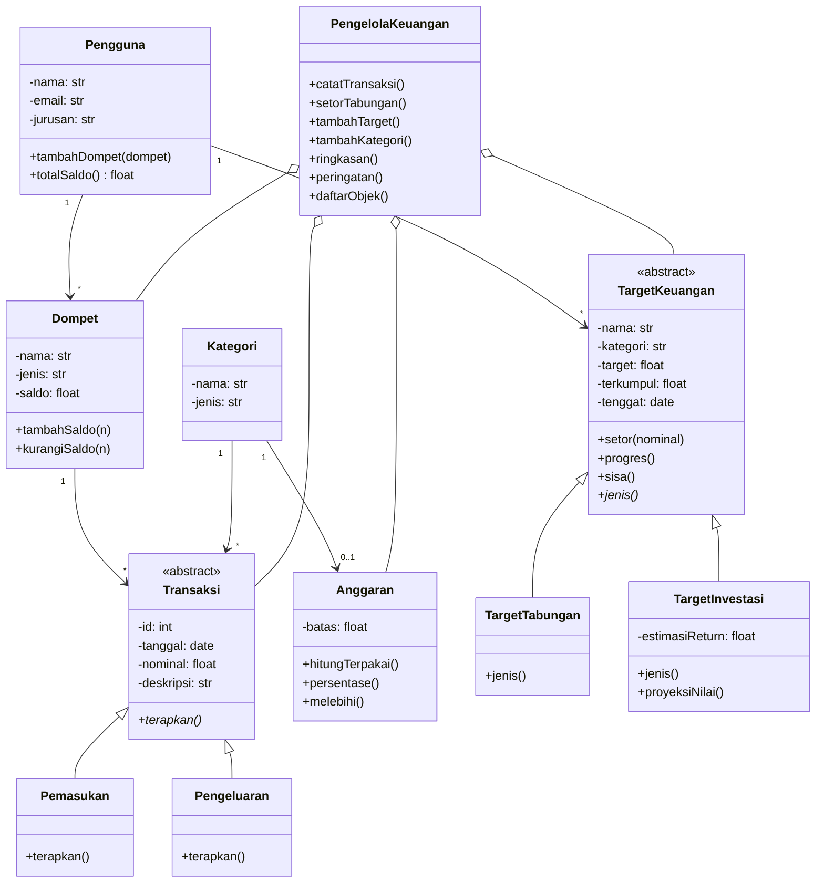

# 💰 DompetKu

Sistem pengelolaan keuangan pribadi mahasiswa berbasis **Pemrograman Berorientasi Objek (Python)** dengan dashboard **Streamlit**. Proyek ini dibuat sebagai Tugas Pengganti UTS mata kuliah PBO.

🔗 **Demo:** https://NAMA-APP.streamlit.app *(ganti dengan link aplikasimu setelah deploy)*

## Latar Belakang

Mahasiswa perantau sering mencatat keuangan secara manual sehingga saldo tidak sinkron, pengeluaran tidak terkontrol, dan target menabung tidak terpantau. DompetKu mencatat transaksi di banyak dompet, memperbarui saldo otomatis, memberi peringatan anggaran, dan memantau target keuangan.

## Fitur

- Pendaftaran pengguna (nama, email, jurusan, saldo awal tiga dompet) dan sapaan "Halo, nama"
- Pencatatan pemasukan dan pengeluaran, dengan saldo dompet yang diperbarui otomatis
- Anggaran bulanan dengan kategori yang bebas dipilih pengguna, lengkap dengan peringatan hampir habis dan terlampaui
- Target keuangan berjenis **Tabungan** atau **Investasi** dengan kategori pilihan, setoran, progres, dan proyeksi nilai investasi
- Input nominal dengan titik ribuan otomatis
- Grafik pengeluaran per kategori
- Tab **Diagram Class** yang menampilkan class diagram, diagram objek sesuai input pengguna, serta tabel Objek, Class, Atribut, dan Method

## Konsep PBO yang Digunakan

| Konsep | Penerapan |
|---|---|
| Enkapsulasi | Atribut private pada `Dompet` dan `Kategori`, diakses lewat property |
| Abstraksi | `Transaksi` dan `TargetKeuangan` adalah abstract class |
| Inheritance | `Pemasukan` dan `Pengeluaran` mewarisi `Transaksi`; `TargetTabungan` dan `TargetInvestasi` mewarisi `TargetKeuangan` |
| Polimorfisme | `terapkan()` menambah saldo di `Pemasukan` dan mengurangi saldo di `Pengeluaran`; `jenis()` berbeda di tiap target |

## Class Diagram



## Menjalankan di Komputer

```bash
pip install -r requirements.txt
streamlit run streamlit_app.py
```

Jika perintah `streamlit` tidak dikenali di Windows, gunakan `python -m streamlit run streamlit_app.py`.

## Struktur Repository

```
dompetku/
├── streamlit_app.py   # model OOP + tampilan dashboard
├── requirements.txt   # daftar library
└── README.md
```

## Catatan

Data disimpan di memori sesi, sehingga hilang saat halaman di-refresh.
